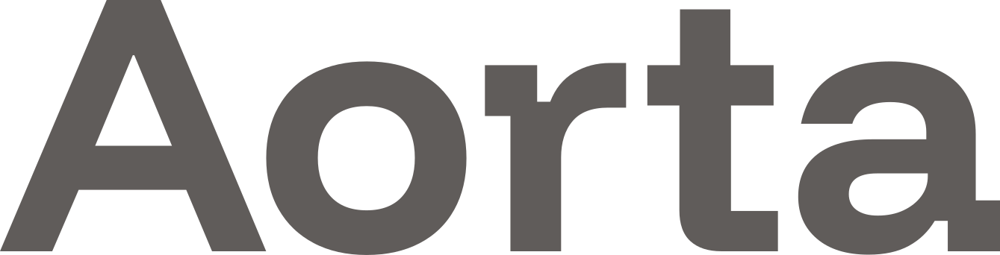
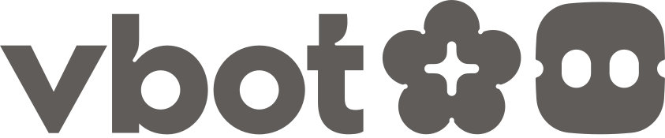

<p align="center">
  <picture>
    <source media="(prefers-color-scheme: dark)" srcset="docs/assets/brand/aorta-dark.svg">
    
  </picture>
</p>
<p align="center"><b>The main artery of robot software</b></p>

Aorta™ provides typed pub/sub, RPC, executors, and schema discovery for robotics,
with Rust, C++, and Python SDKs over Zenoh.

## Get started

```bash
git clone --branch v0.1.0 https://github.com/VitaDynamics/Aorta.git
cd Aorta
bazel build //cpp/examples:talker //rust/examples:listener
```

Follow [QUICKSTART.md](QUICKSTART.md) for the router, cross-language examples,
RPC, and recording. Bazel 7.6.1 is the authoritative build and downloads the
pinned Rust and FlatBuffers toolchains. Linux x86_64 and aarch64 are supported.

## Build and test

```bash
bazel test //core:aorta_core_test //rust:aorta_sdk_test //cpp:cpp_unit_tests
bazel build @flatbuffers//:flatc
export FLATC="$PWD/$(bazel cquery --output=files @flatbuffers//:flatc 2>/dev/null | head -1)"
export AORTA_FLATBUFFERS_ROOT="$(bazel info output_base)/external/flatbuffers~"
cargo build --locked
```

Cargo requires Rust 1.92.0 and the pinned flatc above. Run tests serially when
multiple local Zenoh sessions would conflict.

The lightweight Python check is:

```bash
python3 -m pip install pytest==8.4.2 flatbuffers==25.12.19
python3 -m pytest -o addopts= -q python/tests/test_options.py
```

Full build, lint, Python, wheel, and schema checks are defined in
[.github/workflows](.github/workflows). The lint command applies the upstream
Clippy policy: Core and Rust SDK warnings block except for the existing deferred
design/API categories; tool checks, including `aorta-trace2perfetto`, report
advisory results. The deferred policy and command scopes share one source in
`.github/scripts/mirror_ci.py`. Linux wheels use versioned builds:

```bash
python3 .github/scripts/mirror_ci.py python-wheels --event-name workflow_dispatch --ref-name main --version-input 0.1.0 --include-messages true
```

## SDKs and contributions

- [Rust SDK](rust/README.md)
- [C++ SDK](cpp/README.md)
- [Python SDK](python/README.md)
- [Schema tools](message/README.md)
- [Contributing](CONTRIBUTING.md)
- [Security](SECURITY.md)
- [License and dependency notices](docs/licensing.md)
- [Trademarks](TRADEMARKS.md)

Public releases use SemVer tags such as `v0.1.0`. Each release stamp records
its source revision and paired source tag.

The initial public release does not accept external code contributions or pull requests.
External pull requests will be closed without review. Use GitHub Issues for bugs
and feature requests; report security vulnerabilities privately as described in
SECURITY.md. We plan to open contributions later, after contributors sign an
individual or corporate CLA. The process will be published in CONTRIBUTING.md.

---

<p align="center">
  Developed and maintained by
  <picture>
    <source media="(prefers-color-scheme: dark)" srcset="docs/assets/brand/vbot-dark.svg">
    
  </picture>
</p>

Aorta™ and the vbot logo are trademarks of VitaDynamics. The Apache License 2.0
does not grant permission to use these trademarks; see [TRADEMARKS.md](TRADEMARKS.md).
